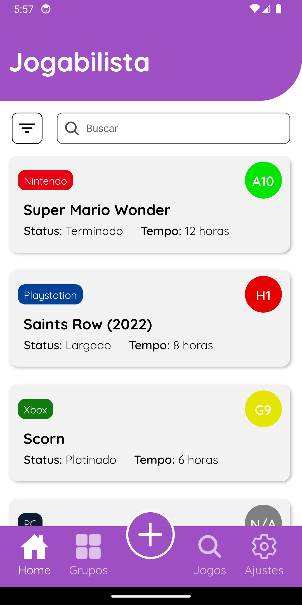
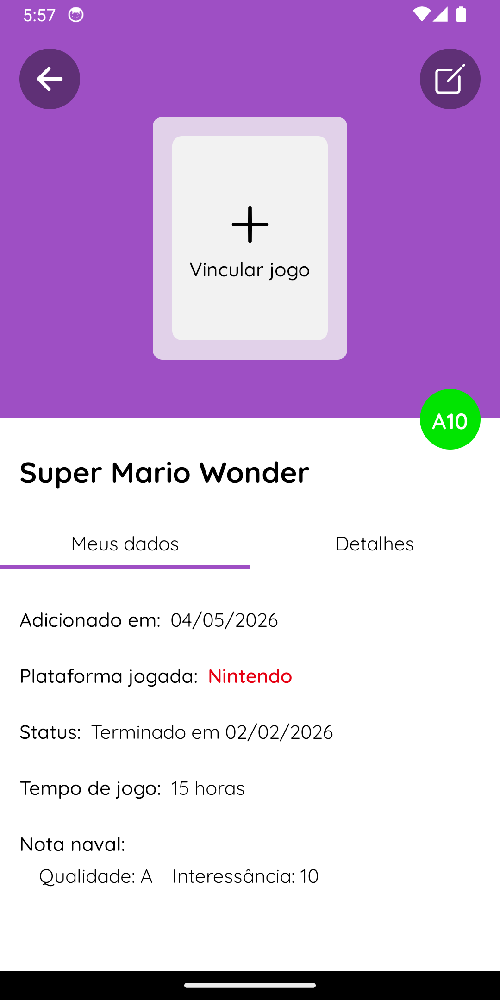

<h1 align="center">Jogabilista</h1>

<p align="center">
  <strong>Versão 1.0.2</strong>
</p>

<p align="center">
  
  
</p>

---

App para buscar, catalogar e avaliar jogos em um acervo pessoal. O app permite cadastrar novos jogos, realizar buscas por título e/ou filtros, organizá-los em grupos e exportá-los em planilhas para excel. A estética e forma de avaliação foram inspiradas no *Jogabilidade* (www.jogabilida.de), um site e podcast de discussão de jogos.

## Features

- **Gerenciamento** - Cadastre, edite e remova jogos da sua coleção.
- **Busca** - Encontre títulos buscando por nome ou filtros específicos.
- **Organização em Grupos** - Categorize seus jogos da forma que preferir.
- **Sistema de Avaliação** - Sistema de avaliação baseado na "nota naval" do jogabilidade, onde é dada uma nota para o quão bom é o jogo e outra para o quão interessante ele é.
- **Exportação de Dados**: Gere planilhas .xlsx dos seus grupos.

## Screenshots

<table align="center">
  <tr>
    <td align="center">
      <br/>
    </td>
    <td align="center">
      <br/>
    </td>
  </tr>
</table>

## Requisitos

- React Native v0.76.9
- Expo v~52.0.49

## Instalação

1. Instale as dependencias

```bash
yarn install
```

2. Inicie o servidor do Expo:

```bash
npx expo start
```

3. Abra o aplicativo:
  - Leia o QR Code exibido no terminal com o app Expo Go no seu celular ou pressione 'a' para emulador Android